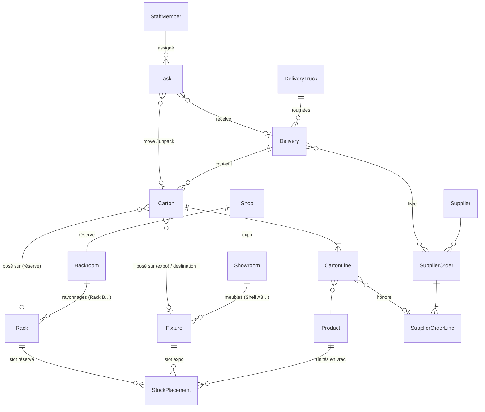

# Inventora — modèle de données

Data layer uniquement (pas d'UI). Les types se trouvent dans `src/domain/`, la forme de la base dans `src/data/schema.ts`.

> **Périmètre des commandes** : dans Inventora, « commandes » désigne uniquement les **commandes fournisseurs** (réapprovisionnement de la boutique, `SupplierOrder`). Il n'y a pas de commandes clients. Les ventes en boutique ne sont tracées que comme mouvements de stock (`units_sold`).

## Relations



## Cycle de vie d'un carton

`location.kind` dit **où** est le carton, `status` dit **dans quel état**. Les combinaisons autorisées sont vérifiées par `checkInvariants`.

| Emplacement (`location.kind`) | Statuts possibles |
|---|---|
| `in_truck` | `in_transit` |
| `receiving` | `received`, `unpacking`, `empty`, `damaged` |
| `backroom` / `showroom` | `stored`, `unpacking`, `empty`, `damaged` |
| `disposed` | `empty`, `damaged` |
| `returned_to_supplier` | `returned` |

```
camion ──unload──▶ réception ──move──▶ Rack B niv.2 ──unpack──▶ Shelf A3 (unités en vrac)
                                                    └─────────▶ Rack B (vrac réserve)
```

## Où est un article ?

Un produit peut se trouver à trois endroits, tous calculés par `productStock()` :

1. **En expo** : `StockPlacement` avec `slot.area = 'showroom'`
2. **En réserve, en vrac** : `StockPlacement` avec `slot.area = 'backroom'`
3. **Dans un carton** : `CartonLine.remainingQuantity` d'un carton présent en boutique

Les cartons encore dans un camion comptent comme `incoming`, pas dans le stock disponible.

## Choix de conception

- **Ids brandés** (`CartonId`, `RackId`…) : on ne peut pas passer un id de la mauvaise table.
- **Unions discriminées** pour les emplacements (`ShelfSlot`, `CartonLocation`) et les tâches (`Task`) : chaque variante porte exactement la clé étrangère dont elle a besoin.
- **Camion ≠ livraison** : `DeliveryTruck` représente le véhicule, `Delivery` un passage daté. Ça garde l'historique.
- **Rien de dérivé n'est stocké** : quantité reçue d'une commande, remplissage d'un carton (« Stock Level 65 % ») et stock total sont calculés.
- **Journal `Movement` append-only** pour la traçabilité (qui a déplacé quoi, quand).
- Entiers uniquement : argent en centimes, poids en grammes.
